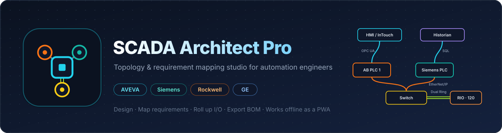
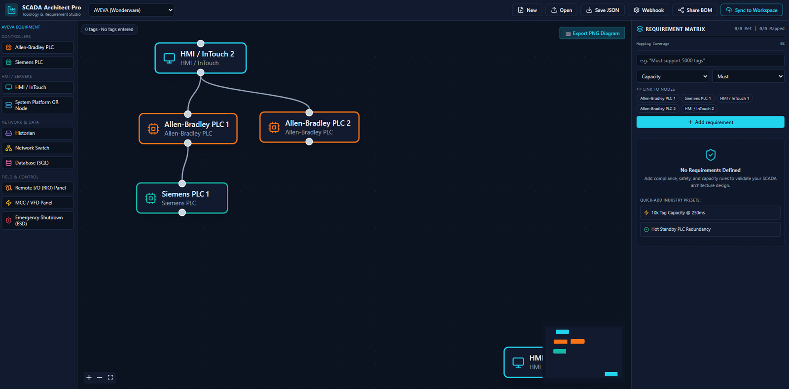
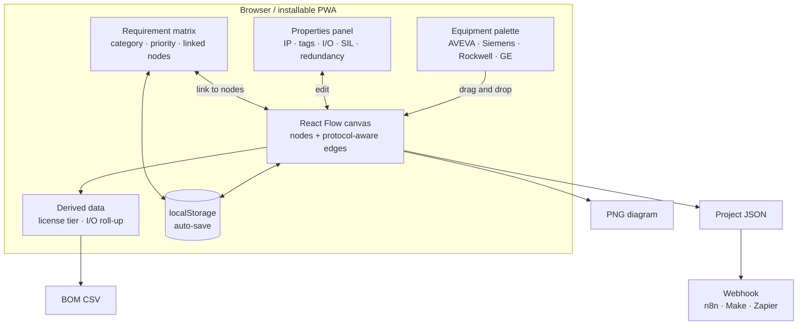
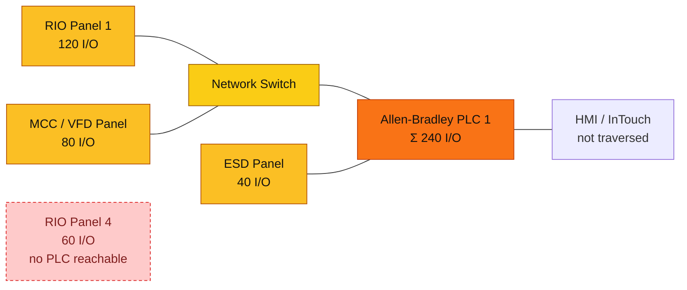
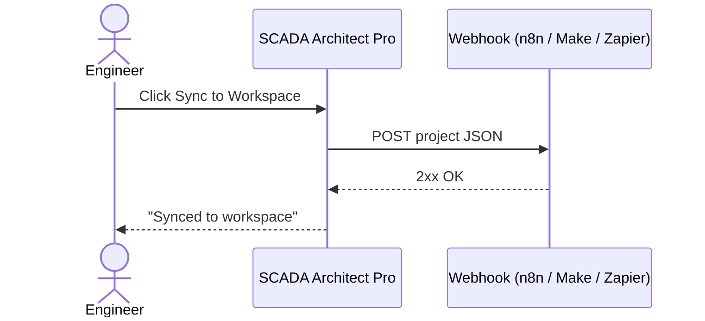

<p align="center">
  
</p>

<p align="center">
  <a href="https://esp046-cyber.github.io/SCADA-Architect-Pro/"></a>
  
  
  
  
</p>

<p align="center">
  <b>Design SCADA architectures, map client requirements to hardware, roll up I/O and export a Bill of Materials, all from a browser or an installable offline app.</b>
</p>

---

## Contents

[Preview](#preview) · [Features](#features) · [Supported ecosystems](#supported-ecosystems) · [How it works](#how-it-works) · [Quick start](#quick-start) · [Using the app](#using-the-app) · [Exports and integration](#exports-and-integration) · [Customising](#customising) · [Deployment](#deployment) · [Project structure](#project-structure) · [Roadmap](#roadmap)

---

## Preview

<p align="center">
  
</p>

> **Try it now:** <https://esp046-cyber.github.io/SCADA-Architect-Pro/>. No sign-up, and your project never leaves your device unless you sync it to a webhook.

---

## Features

| | Feature | What you get |
| :-: | :-- | :-- |
| 🧩 | **Vendor palettes** | Switch between AVEVA, Siemens, Rockwell and GE iFIX. The equipment sidebar changes to match. |
| 🔌 | **Protocol-aware connections** | Tag each link with OPC UA, EtherNet/IP, Modbus TCP, PROFINET, S7 Comm, SuiteLink, MQTT / Sparkplug B, DNP3 or SQL. |
| 🌐 | **Network classification** | Classify links as Control, Business LAN, DMZ or Field Bus. Colours and labels follow the classification. |
| 🔁 | **Redundant rings** | Toggle **Dual Redundant Ring** on a link to draw a double line, ideal for fibre rings and redundant PROFINET. |
| 🖥️ | **Node properties** | Name, IPv4, VLAN, hostname, firmware, tag count, I/O count, redundancy scheme and SIL level, with IPv4 and duplicate-IP validation. |
| 📈 | **I/O roll-up** | Give an RIO, MCC/VFD or ESD panel an I/O count and it aggregates through switches to the nearest PLC. |
| 🏷️ | **Live license estimate** | A running tag total and an indicative license tier sit on the canvas. |
| ✅ | **Requirement matrix** | Capture requirements by category and priority, link them to nodes, and track mapping coverage. |
| 📤 | **Exports** | Project JSON, BOM CSV, PNG diagram, or a webhook sync into your estimating pipeline. |
| 📱 | **Mobile-first PWA** | Install it on a tablet or phone. Auto-saves locally and works offline. |

---

## Supported ecosystems

| Ecosystem | Controllers | HMI / SCADA | Historian | License estimate |
| :-- | :-- | :-- | :-- | :-- |
| **AVEVA (Wonderware)** | Allen-Bradley, Siemens | InTouch HMI, System Platform GR Node | Historian | System Platform tiers, 500 to 100,000 |
| **Siemens (WinCC / PCS 7)** | S7-400H, S7-1500 | WinCC Server, PCS 7 OS, WinCC Client / Panel | Process Historian | WinCC PowerTag tiers, 128 to 102,400 |
| **Rockwell (FactoryTalk)** | Allen-Bradley | View SE Server, Client / PanelView | FactoryTalk Historian | Not configured yet |
| **GE iFIX** | GE PACSystems, Allen-Bradley, Siemens | iFIX SCADA Server, iFIX Client | Proficy Historian | Not configured yet |

Every ecosystem also includes: **network switch, Layer 3 router, industrial firewall, telemetry radio / AP, IoT / edge gateway, SQL database, Remote I/O panel, MCC / VFD panel and Emergency Shutdown (ESD) panel**.

> [!NOTE]
> License tiers are **indicative only**. Always confirm against the vendor's current price list.

---

## How it works

### Architecture



### I/O roll-up

Each field panel (RIO, MCC/VFD, ESD) searches outward through **switches, routers, firewalls, radios and other field panels** and stops at the first PLC it reaches. HMIs, servers and databases do not forward I/O.



- Panels that cannot reach any PLC are flagged **no PLC** on the canvas and counted as *Unassigned* in the BOM.
- A panel that reaches two PLCs at the same distance (for example a hot-standby pair) counts toward **both**, so per-PLC totals can exceed total I/O. The BOM adds a note when this happens.

---

## Quick start

Requires [Node.js](https://nodejs.org/) 18 or newer.

```bash
# 1. Install dependencies
npm install

# 2. Start the dev server (service worker disabled for live reload)
npm run dev
#    -> http://localhost:5173/SCADA-Architect-Pro/   (note the base path)

# 3. Test the production build and PWA install / offline mode
npm run build && npm run preview
```

---

## Using the app

1. **Pick an ecosystem** from the dropdown at the top left.
2. **Drag equipment** from the sidebar onto the canvas. On mobile, tap the floating **+** button.
3. **Connect nodes** by dragging between handles. Select a connection to set its protocol, network type, zone and redundancy.
4. **Select a node** to set its IP, VLAN, hostname, tag count, I/O count, redundancy and SIL.
5. **Add requirements** in the matrix, link each one to the nodes that satisfy it, or start from a quick-add preset.
6. **Export** the project as JSON, a BOM CSV or a PNG, or sync it to your workspace.

### What you can set

| On a node | On a connection |
| :-- | :-- |
| Name, IPv4, VLAN ID, hostname, firmware revision | Industrial protocol (default port shown) |
| Allocated tag count (drives the license estimate) | Network type: Control, Business LAN, DMZ, Field Bus |
| Physical I/O count (field panels only) | Network zone |
| Redundancy: None, Hot Standby, Dual-Ring MRP, Clustered | Dual Redundant Ring toggle |
| Safety integrity level: None, SIL 1 to SIL 4 | |

### Mobile

| Feature | Description |
| :-- | :-- |
| **App-like navigation** | A bottom tab bar switches between the **Studio** canvas and the **Requirements** matrix. |
| **Quick-add button** | The floating **+** opens the equipment drawer without cluttering the screen. |
| **Auto-save and offline** | Edits are saved to `localStorage` immediately. Close the app and resume where you left off. |
| **Native sharing** | Project JSON and BOM CSV go straight to WhatsApp, Slack or email through the share sheet. |

---

## Exports and integration

| Button | Output |
| :-- | :-- |
| **Save JSON** | Full project file (`nodes`, `edges`, `requirements`, ecosystem, licensing and I/O summaries). Reload it with **Open**. |
| **Share BOM** | CSV with the license estimate, I/O summary, equipment summary, node detail, connections and totals. |
| **Export PNG Diagram** | Image of the current canvas. |
| **Sync to Workspace** | POSTs the project JSON to your webhook. |

The BOM CSV is UTF-8 with a byte-order mark so Excel shows special characters correctly. Text cells that start with `=`, `+`, `-`, `@`, tab or carriage return are prefixed with `'` to prevent spreadsheet formula injection.

### Sync to Workspace (webhook)



1. Click **Webhook** and paste your URL. It is stored only in your browser.
2. Click **Sync to Workspace**. The request times out after 15 seconds.
3. Allow this app's origin in your automation platform's CORS settings (for the live site: `https://esp046-cyber.github.io`).

<details>
<summary>Example payload</summary>

```json
{
  "event": "scada_architect.sync",
  "app": "SCADA Architect Pro",
  "version": 3,
  "savedAt": "2026-11-09T04:30:00.000Z",
  "ecosystem": "aveva",
  "licensing": { "product": "AVEVA System Platform", "totalTags": 4200, "indicativeTier": "5,000 I/O" },
  "io": { "total": 360, "assigned": 300, "unassigned": 60 },
  "nodes": [],
  "edges": [],
  "requirements": []
}
```

</details>

---

## Customising

All hardware and licensing definitions live in two small files.

**Add a hardware type** in `src/lib/ecosystems.js`: add it to `NODE_KINDS`, then list its key in an ecosystem's `kinds` array.

```js
my_plc: { label: 'My PLC', icon: Cpu, color: '#f97316', role: 'plc', category: 'controllers' },
```

`role` controls behaviour: `plc` receives rolled-up I/O, `network` forwards it, `field` carries an I/O count, and `hmi`, `server` and `data` are SCADA-layer nodes.

**Set license tiers** in the same file with the `tiers()` helper:

```js
licensing: { product: 'FactoryTalk', tiers: tiers('Tags', [500, 1000, 5000, 25000]) },
```

**Add protocols, network types, SIL levels or redundancy schemes** by editing `PROTOCOLS`, `NETWORK_TYPES`, `SIL_LEVELS` and `REDUNDANCY_TYPES` in `src/lib/scada.js`.

---

## Deployment

The live site is built and published to GitHub Pages by a GitHub Actions workflow on every push to `main`.

- **Sub-path hosting:** `vite.config.js` sets `base: '/SCADA-Architect-Pro/'`. If you fork or rename the repository, change it to match.
- **Choose one method:** the Actions workflow, or `npm run deploy` (which pushes `dist` to a `gh-pages` branch). Running both causes confusion about which version is live.
- **After deploying**, hard-refresh (Ctrl+Shift+R). The service worker caches aggressively, so a normal reload can show the previous version.

### Before you go live

- [ ] In `index.html`, replace `https://your-domain.example/` (canonical, `og:url`, `og:image`, `twitter:image`) with your real URL.
- [ ] Replace the PWA icons (`public/icon-192.png`, `public/icon-512.png`) if you want your own branding. The logo source is [`docs/logo.svg`](./docs/logo.svg).
- [ ] Update `public/manifest.webmanifest` with your app name, description and theme colours.
- [ ] Replace `public/preview.png` with a screenshot of a representative diagram.

---

## Project structure

<details>
<summary>Show the file tree</summary>

```text
SCADA-Architect-Pro/
├── docs/                      # README assets (banner, logo)
├── public/                    # PWA icons, manifest, preview image
├── src/
│   ├── components/
│   │   ├── Header.jsx             # New / Open / Save / Share BOM / Webhook / Sync
│   │   ├── TopologyStudio.jsx     # React Flow canvas, custom nodes and edges
│   │   ├── PropertiesPanel.jsx    # Node and connection inspector
│   │   ├── RequirementPanel.jsx   # Requirement matrix
│   │   ├── ExportButton.jsx       # PNG diagram export
│   │   └── Sidebar/EquipmentPanel.jsx
│   ├── hooks/useLocalStorage.js
│   ├── lib/
│   │   ├── ecosystems.js      # Node kinds, vendor palettes, license tiers
│   │   └── scada.js           # Protocols, validation, licensing, I/O roll-up, BOM CSV
│   ├── App.jsx
│   └── main.jsx
├── index.html
├── vite.config.js
├── tailwind.config.js
└── postcss.config.js
```

</details>

| Layer | Technology |
| :-- | :-- |
| UI | React 18, Tailwind CSS 3, lucide-react icons |
| Canvas | React Flow 11 |
| Build | Vite 5 |
| Offline / install | vite-plugin-pwa (Workbox) |
| Image export | html-to-image |

---

## Roadmap

- [ ] Show topology warnings in the UI. `validateTopology()` in `src/lib/scada.js` already detects ESD nodes without a SIL, controllers without redundancy, unspecified protocols, duplicate IPs and dangling connections.
- [ ] Add license tier tables for Rockwell FactoryTalk and GE iFIX.
- [ ] Add a representative sample project to load from the **Open** menu.

---

<sub>License estimates are indicative and not a quotation. This project is independent and not affiliated with AVEVA, Siemens, Rockwell Automation or GE Vernova. All product names and trademarks belong to their respective owners.</sub>
